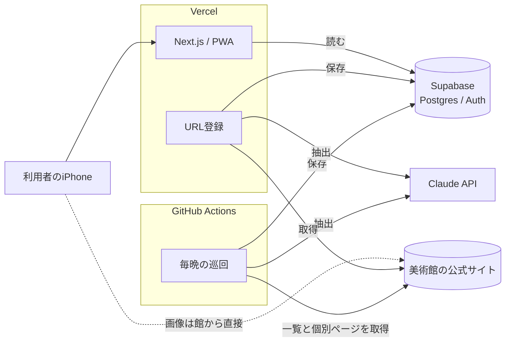
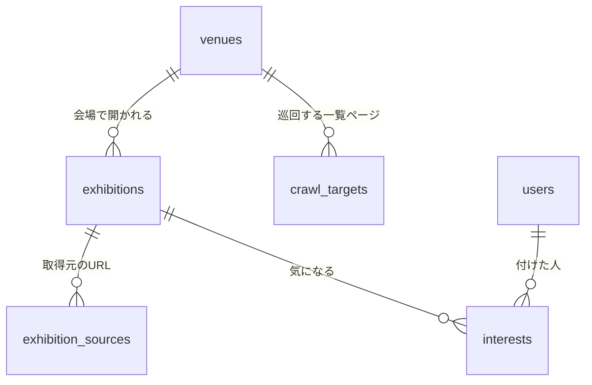

## はじめに

2026年9月30日、展覧会のチラシをまとめて眺められるサービス「チラシミュージアム」が終了しました。

これをよく使っていた友人がいて、困っていました。
欲しいのは、Filmarks のマイページのような体験です。**展示を眺める → 気になるを付ける → 自分のページにチラシが並ぶ**。

そこで、代わりになるアプリ「chirashi-box」を作りました。

https://chirashi-box.vercel.app

この記事では、作ったものの紹介よりも、**なぜこの形にしたのか**を中心に書きます。
主にバイブコーディングベースで作成した個人開発の小さなアプリですが、設計判断の分かれ道はたくさんありました。そのたびに選んだもの、捨てたもの、払ったコストを記録しておきます。

# 機能

- 美術館の展示を、チラシの一覧で眺める（開催中／もうすぐ）
- 気になる展示に「気になる」を付けると、マイページにチラシが並ぶ
- 一覧にない展示は、公式ページの URL を貼れば登録できる
- 展示の情報は、毎晩、各館の公式サイトから自動で集める

## 全体の構成



| 役割 | 使ったもの |
|---|---|
| 画面 | Next.js（App Router）を Vercel で配信し、PWA としてホーム画面に追加してもらう |
| データと認証 | Supabase（Postgres、Auth、RLS） |
| 展示情報の収集 | GitHub Actions の cron で毎晩巡回し、Claude で展示名・会期・会場を抜き出す |
| URL 登録 | 巡回と同じ抽出関数を、Next.js のサーバー側から呼ぶ |

ここから、判断を一つずつ見ていきます。

---

## 判断の土台にした2つの方針

個別の判断に入る前に、全体を通して効いている方針が2つあります。

### 1. 「今は小さいから」を理由に設計を選ばない

会場の扱いを考えているとき、「既存の会場一覧を丸ごと LLM のプロンプトに入れて照合させる」「新しい会場は開発者が手で確認する」という案がLLMから出ました。

どちらも、利用者が数人、会場が数十館だから成り立つ案です。会場や利用者が増えると、プロンプトのサイズや開発者の作業が比例して増えていきます。

そこで、**データや利用者が増えたときに、開発者の手作業やプロンプトが比例して増える設計は選ばない**と決めて指示しました。人の確認が必要なら、開発者に集めず、その操作をする利用者本人に分散させます。


### 2. データの取り方の決まりは、運用ではなく仕組みで守る

このアプリは他人のサイトから情報を集めます。著作物を扱うサービスなので、厳重に守るべき決まりがあります。

- 保存するのは、展示名・会期・会場・URL といった**事実の情報だけ**。解説文は明確に著作物であるため保存しない
- まとめサイトから取らない。館や主催者の公式ページから取る
- robots.txt と各サイトの利用規約に従う

これらを「気をつける」で済ませてしまうのは危険です。できるだけ仕組みで守れるように設計しました。

- 抽出のスキーマにも、データベースのテーブルにも、**解説文を入れる場所を作らない**
- robots.txt は取得のたびに機械的にチェックする。User-Agent でアプリ名と連絡先を名乗る
- URL 登録では、ページの出どころを判定して、第三者のページは断る

---

## 判断1：ネイティブアプリではなく PWA

| 案 | 見送った理由 |
|---|---|
| Expo（React Native） | Mac なしでもビルドはできるが、配るには TestFlight と Apple Developer Program の年会費が要る |
| Kotlin Multiplatform | 私の得意分野だが、iOS のビルドに Mac が要る。web 版は iOS Safari での日本語入力などに不安がある |
| SvelteKit | 書く量は少ないが、Supabase と組み合わせる例が Next.js より少ない |

アプリの中心は一覧・記録・検索で、カメラやバックグラウンド処理のようなネイティブの機能はほぼ要りません。
そして何より、**友人の反応を見ながら直すサイクルを速く回したい**。審査なしで更新がすぐ届く PWA が合っていました。

払ったコストは、iPhone にはインストールを促す仕組みがないことです。共有ボタン →「ホーム画面に追加」の手順を案内するバナーを自前で出しています。また、筆者が初めて本格的にリリースしたwebサービスであるため、学習コストもいくらか払っています。

## 判断2：収集処理も TypeScript で書く

展示情報の取り込み口は2つあります。毎晩の巡回と、利用者による URL 登録です。どちらも「ページを取得 → LLM で構造化して抜き出す」という同じ処理を使います。

私は普段 Kotlin を書いているので、収集だけ Kotlin で書く案もありました。
しかし、URL 登録は利用者の操作をきっかけにその場で動きます。Next.js のサーバー側から抽出関数を呼ぶ必要があります。収集を Kotlin にすると、

- そのためだけに Kotlin のサーバーを常時動かす（常時動くサーバーがない構成の良さが消える）
- または、TypeScript で同じ処理をもう一度書く

のどちらかになります。データベースの型も2言語で二重に管理することになります。

なので、抽出関数は TypeScript の1モジュールにして、巡回スクリプトと URL 登録の両方から import しています。Supabase が生成する型も共有できます。LLM の出力の型は Zod のスキーマで担保しています。

## 判断3：巡回は GitHub Actions の cron で行う

巡回は館のサーバーに配慮して、1館ずつ間隔をあけて取得します。なので会場が増えるほど、1回の実行が長くなります。

| 案 | 評価 |
|---|---|
| Vercel Cron / Supabase Edge Functions + pg_cron | サーバーレス関数は実行時間が短い。ゆっくり回ると時間切れになり、結局キューが要る |
| DB にキューを持ち、ワーカーが取り出す | 規模が大きくなっても並列化できる正しい形。ただ今の規模では、ロックや再試行の管理が過剰 |
| **GitHub Actions の cron** | 1ジョブを数時間動かせる。ログが残り、手動の再実行も簡単 |

GitHub Actions を選びましたが、方針1（今は小さいからで選ばない）との整合も取っています。
巡回スクリプトを「会場1つを処理する関数」と「それを順に呼ぶループ」に分けました。規模が大きくなったら、matrix で会場を分けて並列にするか、キューに移せばよく、会場を処理する関数はそのまま使えます。

## 判断4：LLM をどこに、どれだけ使うか

### 一覧ページから個別ページを選ぶ

館ごとに一覧ページの作りはバラバラです。個別の展示ページの URL をどう集めるかで迷いました。

- 館ごとに URL パターン（正規表現）を書く：決定的で費用もかからない。でも館を足すたびに開発者がパターンを書くことになり（方針1に反する）、サイトが改装されると拾えなくなる
- **一覧ページの同じサイト内のリンク（文字と URL の組）だけを LLM に渡して選ばせる**：HTML 全体は渡さないので安い

後者にしました。ただ、テーブルにはパターン用の列だけ先に用意してあります。LLM の判定が不安定な館が出てきたら、その館だけパターンで上書きできます。

### 変わったページだけ LLM に通す

毎日すべてのページを LLM に通すと、何も変わっていないページの分まで毎日費用がかかります。館を増やすほど無駄が増えます。

なので、ページの主要部分のハッシュを保存しておき、変わったものだけ LLM に通しています。

- 一覧ページのハッシュが前回と同じなら、その館はそこで終わり
- 新しい個別ページだけ抽出する
- 既知のページはハッシュを比べて、変わっていたら抽出し直す
- 会期が終わった展示のページは、もう取得しない

LLM の費用は、館の数ではなく**新しく出た展示と変わった展示の数**に比例します。

### Batch API をやめた

最初は、巡回は急がない処理なので Message Batches API（料金が半額、結果は非同期）に流すつもりでした。

ところが組み立ててみると、巡回の LLM 処理は3段階が順に並んでいました。

1. 一覧のリンクから個別ページを選ぶ
2. 個別ページから抜き出す
3. 名前が一致しない重複候補を判定する

Batch の結果は通常1時間以内ですが、最長24時間かかります。3段階それぞれで投入・待機・回収を繰り返し、時間切れに備えて途中から再開する仕組みも要ります。毎日1段階ずつ進める案だと、新しい展示が出るまで3日かかります。

差分処理のおかげで、半額にして浮く額は月に数百円程度の見込みでした。それと引き換えに巡回のコードを一番複雑にする価値はない、と判断して、通常の API で同期的に呼ぶことにしました。巡回と URL 登録が同じ抽出関数をそのまま使えるという利点も残ります。

---

## 判断5：データモデル

データベースの中心部分はこうなっています。



### 展示は URL ではなく「会場 × 会期」で決まる

1つの展示に、紹介ページが複数あることはよくあります。館のページと、主催者の特設サイトなどです。館がサイトを改装すれば URL も変わります。

| 案 | 問題 |
|---|---|
| 公式 URL を一意のキーにする | 館のページと特設サイトが別の展示として二重に登録される |
| 会場 + 正規化した展示名 + 開始日を一意にする | LLM の抽出結果は表記が揺れる（「」の有無、サブタイトル、全角と半角）ので、完全一致では二重になりやすい |

なので、展示（`exhibitions`）と取得元の URL（`exhibition_sources`）を別の表にしました。照合は3段階です。

1. 取得元の URL が既にあれば、その展示
2. なければ、同じ会場で会期が重なる展示を候補にし、正規化した展示名が一致するか、一方が他方を含んでいれば、その展示に紐づける
3. 該当がなければ新しい展示

候補はあるのに名前が一致しない場合は、経路で判定方法を分けました。

- **URL 登録**：登録者に「すでにある『〇〇展』と同じ展示ですか？」と聞く
- **巡回**：聞く相手がいないので、LLM に判定させ、根拠を `match_reason` 列に残す

決定的に判定できるところは決定的に、人に聞ける場面では人に、残りだけ LLM に。この考え方は、他の判定でも揃えています。

### 会場は Google の place_id で見分け、保存するのはそれだけ

「〇〇美術館」と「〇〇美術館（△△タワー53階）」を、名前で同じ会場と判定するのは難しいです。名前で照合して、なければ自動で作る方式だと、表記の揺れで会場が二重になってしまいます。

そこで、LLM には会場名と住所を抜き出させるだけにして、それを Google Places API で検索し、返ってきた `place_id` で同じ会場かを決めます。

ここで規約の壁がありました。Google の規約では、`place_id` 以外の情報（座標など）を保存できる期間に制限があります。キャッシュしてよい期間が明示されていない項目もあります。

結局、**Places から保存するのは `place_id` だけ**にしました。同一性の判定には、無料の Text Search（IDs Only）で足ります。会場名と住所は、館のページから LLM が抜き出したものを保存します。

払ったコストは、座標を持てないので「近くの展示」などの機能がそのままでは作れなくなったことです。

---

## 判断6：認証は段階的に

| 操作 | 必要なもの |
|---|---|
| 展示を眺める | 何も要らない |
| 気になるを付ける | 匿名のアカウント（Supabase の匿名サインイン） |
| URL 登録 | メールで確認したアカウント |

URL 登録は LLM と Places API を呼ぶので、1回ごとにお金がかかります。使い捨ての匿名ユーザーに叩かせると、作り直せばレート制限も回避されます。なので URL 登録だけはメールの確認を必須にしました。
一方で、チラシを眺めたいだけの人に、入り口でログインさせたくはありません。

匿名ユーザーを作るタイミングにも分かれ道がありました。アプリを開いた時点で作れば、どのページでもユーザーがいる前提で書けて単純です。でも、眺めるだけの訪問者やクローラーのアクセスのたびにユーザーが作られ、`auth.users` が訪問の数だけ増えます。
なので、**初めて「気になる」を押した時点で作る**ことにしました。

### メールはリンクではなく6桁のコード

ホーム画面に追加した PWA では、メールのリンクを開くと Safari 側で開いてしまい、アプリ側ではログインできません。なので6桁の確認コードでログインします。

ところが、Supabase の無料プランで組み込みのメール送信を使っていると、メールのテンプレートを変更できませんでした。既定のテンプレートにはリンクしか入っていません。

月25ドルの有料プランにするより、外部のメール送信サービス（SMTP）をつないで無料プランのままテンプレートを変える方を選びました。

---

## 判断7：画像とリンクは「保存しない」「表示のときに決める」

### 画像は館のサーバーから直接読み込む

チラシの画像は、このアプリの存在理由そのものです。でも、画像には権利があります。

| 案 | 評価 |
|---|---|
| 自前のサーバーにキャッシュして配信する | 表示は安定するが、複製と公衆送信にあたり、許諾がないうちは一番リスクが高い |
| 画像を使わず、自動で作ったカードだけにする | 権利のリスクはゼロ。でも「チラシが並ぶ楽しさ」がなくなる |
| **画像は保存せず、館が指定した画像（主に og:image）をブラウザから直接読み込む** | 複製しない。取れなければ自動で作ったカードにする |

3つ目を選びました。画像はトリミングせず、`object-fit: contain` で全体を表示します。

払ったコストは、館がページを消すと画像も消えることです。終わった展示は、だんだん自動で作ったカードに置き換わっていきます。これは受け入れることにしました。

### サイトごとの決まりを、表示のときに当てはめる

実際に館の利用規約を読むと、サイトによって決まりがまちまちでした。

- 「リンクを張るには許可が必要」
- 「画像への直接リンクはご遠慮ください」

そこで、ドメインごとに「リンクを出してよいか」「画像を出してよいか」を持つ表（`site_policies`）を作りました。
ポイントは、**保存するデータは変えず、表示するときに当てはめる**ことです。許可が取れたら、行を1つ変えるだけで本来の表示に戻ります。

さらに、URL 登録では、規約を確認していない新しいドメインのページも入ってきます。なので、`site_policies` に行がないドメインは「未確認」とみなし、リンクは出すが画像は出さない、を既定にしました。

### 複数の展示で同じ画像は出さない

本番に出してみると、ある館の展示がすべて館のロゴ画像になっていました。og:image に、展示ごとの画像ではなくサイト共通のロゴが指定されていたためです。別の館では、ある展示のページに、隣の展示のポスターが og:image として入っていました。

LLM にページ内の画像からチラシらしいものを選ばせる案もありました。ただ、渡す情報が増えて料金が上がりますし、出品作品の1枚を選ぶなど、間違いを確かめにくくなります。

そこで、**2件以上の展示で同じになっている画像は、チラシとして出さない**ことにしました。判定はデータベースのビューで行います。

```sql
create view public.shared_image_urls
  with (security_invoker = true)
as
select image_url
from public.exhibitions
where image_url is not null
group by image_url
having count(*) > 1;
```

表示側は、サイトの決まりを当てはめたあとに、これを通すだけです。

```ts
export function flyerImageOf(imageUrl: string | null, sharedImageUrls: ReadonlySet<string>): string | null {
  return imageUrl && !sharedImageUrls.has(imageUrl) ? imageUrl : null;
}
```

**間違った画像を出すより、出さない方がいい**という判断です。正しいポスターが一緒に隠れることもありますが、自動で作ったカードになるだけで、表示は壊れません。

---

## 実際の美術館サイトにぶつかって変えたこと

ここまでの設計はClaudeとの壁打ちによって決めたものです。実際の館のサイトで巡回してみると、想定外がいくつもありました。

### 1館で$2.3かかった

ある館を巡回したら、それだけで API を133回呼び、約$2.3かかりました。登録された123件のうち117件は、会期が終わった展示でした。古いものは2012年です。一覧ページに過去の展示へのリンクも並んでいて、リンク選びがそれも選んでいたのです。

リンクを選ぶ LLM に**今日の日付を渡し**、リンクの文字や URL から明らかに終わったと分かる展示は選ばせないようにしました。分からないものは選ばせます。

結果、対象の館すべてを回っても API は67回、約$1になりました。登録された38件は、すべて開催中かこれからの展示でした。

### HTML にリンクが1本もない

ある館の一覧ページは、JSON を読み込んで JavaScript で組み立てていました。HTML を取得しても、リンクが1本もありません。

ヘッドレスブラウザで JavaScript を実行する手もありますが、1館のために巡回全体が重くなります。
代わりに、一覧が JSON の場合は、その中から同じサイトのページを指す値を探し、同じ項目の文字（展示名・会期など）を添えて、HTML と同じリンク選びに渡すようにしました。

### Readability が本文を取り違えた

ページの主要部分を取り出すのに Readability を使っていました。ところがある館では、解説文だけを選んで展示名と会期を落としたり、クッキーの案内を本文と取り違えたりしました。

結果が短いときだけ切り替える案も考えましたが、「長いけれど中身が違う」失敗は見分けられません。
なので、ページに `<main>` があればそこから `script` や `nav` などを除いた文字を本文にし、`<main>` がない場合だけ Readability を使うようにしました。

### クラウドからのアクセスだけ断られる

ある館の一覧は、手元のパソコンからは取れるのに、GitHub Actions からは毎回 HTTP 403 が返りました。データセンターの IP アドレスからのアクセスを、まとめて断っているとみられます。

手元のパソコンから巡回すれば、すぐに展示を出せます。でも、館がはっきり断っているアクセスをすり抜けることになります。

なので、**IP アドレスや User-Agent を変えるような回り道はしない**と決めて、その館の巡回は止めました。今は館に許可をお願いしているところです。

---

## 決定を記録しながら作る

ここまでの判断は、すべて「Any Decision Record（AnyDR）」として、リポジトリに1件1ファイルで残しています。ADR の対象をアーキテクチャに限らず、ツール選びや命名、「やらないと決めたこと」まで広げたものです。

https://zenn.dev/dress_code/articles/c73500ae73361c

今回の開発は Claude Code と対話しながら進めました。設計を詰めるときは、選択肢ごとに Pros/Cons を出してもらい、決まったものはその場で AnyDR に書いてもらいます。このブログの執筆時点で29件あります。

記録しておいてよかったと思った場面が何度もありました。

- 「Batch API に流す」と決めた記録があったので、後で見直したときに「何を前提に決めていて、何が変わったから覆すのか」をはっきり書けた
- 「今は小さいから」で選ばないという方針を最初に記録したので、その後の判断で同じ議論を繰り返さずに済んだ
- この記事も、ほぼ AnyDR を読み返しながら書いています

## まとめ

振り返ると、判断の多くは同じ形をしていました。

- **保存しない／表示のときに決める**：画像、Places の情報、サイトごとの決まり。後から許可や規約が変わっても、データを直さずに済む
- **決定的に判定できるところは決定的に、人に聞けるところは人に、残りだけ LLM に**：重複の照合、ページの出どころの判定、会場の同一性
- **規模が大きくなったときに作り直しにならない形にしつつ、機能は絞る**

これから友人に使ってもらいながら、「ここが見づらい」を一つずつ直していくつもりです。
