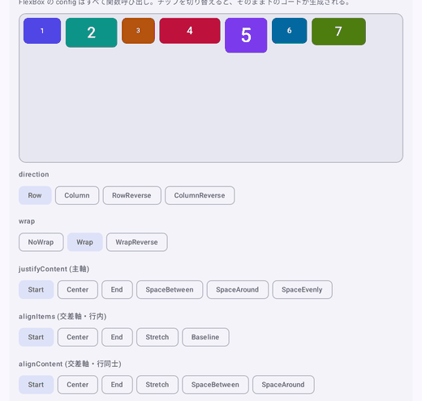
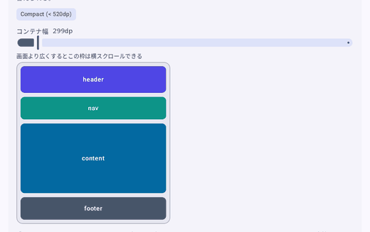

## まず結論

2026年11月18日、**Jetpack Compose 1.13 が stable になりました**。
そして今回の目玉、`FlexBox` と `Grid` が experimental から卒業しました 🎉

```kotlin
implementation(platform("androidx.compose:compose-bom:2026.11.01"))
```

この2つ、ざっくり言うとこういう子たちです。

| | 何者 | こんなときに |
| --- | --- | --- |
| **FlexBox** | CSS Flexbox 系の1次元レイアウト。`Row` / `Column` / `FlowRow` / `FlowColumn` の上位互換 | 1行の中で「誰が伸びて誰が縮むか」を決めたい |
| **Grid** | CSS Grid 系の2次元レイアウト | 画面の骨格そのものを組みたい |

せっかくなので、**触って確かめられるデモアプリを作りました**(claudeが)。
この記事はその制作記録 兼 入門ガイドです。

https://github.com/ItisNoMatter/compose-1.13-layout-lab

クローンして `Run` するだけで動きます。記事に貼った GIF は全部このアプリのものです。

:::message
Compose 1.13 は **Kotlin 2.2 以上**と **compileSdk 37.1** を要求します。ここ、地味にハマるので後述します。
:::

## なぜ今これが熱いのか

地味なんですが、同じリリースで **`ConstraintLayout` と `MotionLayout`（Compose 版）が非推奨になりました**。

> With the introduction of more modern layout and animation tooling in Compose and new Shared Element APIs---we are officially deprecating `ConstraintLayout` and `MotionLayout` in Compose

つまり「複雑な2次元レイアウトは ConstraintLayout で」という逃げ道が閉じて、その受け皿として `Grid` が stable になった、という流れです。

`FlexBox` の方も、公式がはっきり言い切ってます。

> FlexBox supersedes the Flow layouts (`FlowRow` and `FlowColumn`), and we recommend using `FlexBox` instead of Flow layouts for new code.

**新規コードで `FlowRow` / `FlowColumn` を書く理由はもうない**ということですね。既存コードを慌てて書き換える必要はないですが、新しく書くなら `FlexBox` です。

## FlexBox編

### config がぜんぶ持っていく

まずこれを見てください。`FlexBox` の設定は、ぜんぶ `config` という1つのブロックに関数呼び出しで書きます。

```kotlin
FlexBox(
    modifier = Modifier.fillMaxWidth().height(240.dp),
    config = {
        direction(FlexDirection.Row)
        wrap(FlexWrap.Wrap)
        justifyContent(FlexJustifyContent.SpaceBetween)
        alignItems(FlexAlignItems.Center)
        alignContent(FlexAlignContent.SpaceAround)
        gap(8.dp)
    },
) {
    repeat(7) { Swatch("$it") }
}
```

CSS を書いたことがある人なら、たぶん説明不要レベルで見覚えのある単語が並んでいると思います。実際に動かすとこんな感じ。



やっていることを順に：

1. 初期状態（`Row` + `Wrap`、7個が1行に収まっている）
2. **`maxItemsInEachLine(3)`** → 1行3個で強制改行
3. `justifyContent(SpaceBetween)` → 主軸方向に散らばる
4. `alignItems(Center)` → 行の中で縦センター揃え
5. `alignItems(Stretch)` → 行の高さいっぱいに伸びる
6. `alignContent(SpaceAround)` → 行**同士**が縦に散らばる
7. `direction(Column)` → 主軸が縦に

2番目の `maxItemsInEachLine` が **1.13 の新機能**です。「折り返すのはいいけど1行3個までにしたい」という、グリッドっぽいけどグリッドじゃないやつを素直に書けます。

:::message
`alignItems` は「**行の中**で子をどう揃えるか」、`alignContent` は「**行そのもの**を交差軸方向にどう配置するか」です。混同しがちですが、`alignContent` は折り返しが起きていないと効果がありません。
:::

### 子は grow / shrink / basis を主張する

親が `config` で全体の方針を決めるのに対し、子は「自分がどう伸び縮みしたいか」を `Modifier.flex {}` で主張します。

```kotlin
FlexBox(modifier = Modifier.fillMaxWidth()) {
    Box(Modifier.flex { grow(1f) })    // 余白の 1/3 をもらう
    Box(Modifier.flex { grow(2f) })    // 余白の 2/3 をもらう
    Box(Modifier.flex { shrink(0f) })  // 幅が足りなくても縮まない
}
```

- `grow` … 余った幅を奪う比率。既定は `0f`（伸びない）
- `shrink` … 足りないときに縮む比率。既定は `1f`（縮む）
- `basis` … 伸縮を計算する前の初期サイズ。`Auto` / `Dp` / `Percent` が選べる

`Row` + `Modifier.weight()` でやっていたことの上位互換ですね。`weight` は「余白の分配」しかできませんでしたが、`shrink` と `basis` が加わったことで**足りないときの振る舞い**まで宣言できるようになったのが大きいです。

### 設定を「値」として配り回せる

個人的に一番好きなポイントがこれ。`FlexBoxConfig` は**値**なので、トップレベル定数として置いて、`then` で合成できます。

```kotlin
val ToolbarBase = FlexBoxConfig {
    direction(FlexDirection.Row)
    alignItems(FlexAlignItems.Center)
    gap(8.dp)
}
val Dense = FlexBoxConfig { gap(2.dp) }

FlexBox(config = ToolbarBase then Dense) { /* ... */ }
```

……と書くと「合成って何が起きてるの？」となると思うので、順に説明します。

#### FlexBoxConfig は「設定値の束」ではなく「手順書」

ここが分かれば一気に腑に落ちます。`FlexBoxConfig` の正体は、メソッドを1つしか持たない `fun interface` です。

```kotlin
public fun interface FlexBoxConfig {
    public fun FlexBoxConfigScope.configure()   // これだけ
}
```

つまり `FlexBoxConfig { direction(...); gap(8.dp) }` は、**設定値を詰めた箱ではなく、「セッターをこの順に呼べ」という手順書**です。書いた時点ではまだ何も実行されていません。measure のときに Compose が内部の可変オブジェクトを1つ用意して、そこに対して `configure()` を実行します。

#### then は「続けて実行する」だけ

正体はこれだけです。

```kotlin
internal class CombinedFlexBoxConfig(vararg val configs: FlexBoxConfig) : FlexBoxConfig {
    override fun FlexBoxConfigScope.configure() {
        configs.forEach { config -> with(config) { configure() } }  // 順番に実行
    }
}
```

なので、さっきの `ToolbarBase then Dense` で measure 時に実際に走るのは、ただの4行です。

```kotlin
direction(FlexDirection.Row)        // ToolbarBase
alignItems(FlexAlignItems.Center)   // ToolbarBase
gap(8.dp)                           // ToolbarBase
gap(2.dp)                           // Dense ← 同じプロパティなので後勝ち
```

結果は `direction = Row`、`alignItems = Center`、`gap = 2dp`。公式の KDoc もそう言っています。

> Configs further "to the right" will override properties to the left of them, **on a per-property basis**.

**プロパティ単位で後勝ちマージ**です。CSS のクラスを2つ当てる感覚にかなり近い。

- 左にしかないプロパティ → そのまま残る
- 両方にあるプロパティ → 右が勝つ
- どちらにもない → `FlexBox` の既定値

:::message alert
`Modifier.then()` と形は同じですが**意味が違います**。`Modifier` は積み上げ（`padding(8.dp).padding(4.dp)` は合計12dpの余白）、`FlexBoxConfig` は上書き（`gap(8.dp)` のあと `gap(2.dp)` なら 2dp）です。
:::

#### 嬉しいポイント1: 「共通の土台 + 差分」で書ける

```kotlin
// アプリ全体で共有する土台
val ToolbarBase = FlexBoxConfig {
    direction(FlexDirection.Row)
    alignItems(FlexAlignItems.Center)
    gap(8.dp)
}

// 画面ごとの差分だけを足す
val DenseToolbar = ToolbarBase then FlexBoxConfig { gap(2.dp) }
val WrapToolbar  = ToolbarBase then FlexBoxConfig { wrap(FlexWrap.Wrap) }
```

土台を直せば全部に効きます。「デザインシステムのトークンとして配れる」というのはこういう意味です。

#### 嬉しいポイント2: 「何もしない設定」が値として存在する

`FlexBoxConfig` の companion object 自身が `FlexBoxConfig` を実装していて、`configure()` が空っぽです。

```kotlin
public companion object : FlexBoxConfig {
    override fun FlexBoxConfigScope.configure() {}             // 何もしない
    override fun then(other: FlexBoxConfig): FlexBoxConfig = other
}
```

何と合成しても相手がそのまま返る、という性質ですね。公式サンプルはこれを **identity element（単位元）** と呼んでいます。

```kotlin
// FlexBoxSample.kt より
// An empty call returns the default identity element gracefully without allocations
val EmptyExtension = FlexBoxConfig()
```

ソース側にも `Identity elision: merging the identity with any config yields that config.` というコメントがあります。`Modifier.Companion` が `then(other) = other` を返すのとまったく同じ仕組みです。

おかげで、条件付きの設定を `if` 式のまま素直に書けます。

```kotlin
val extra = if (isCompact) FlexBoxConfig { wrap(FlexWrap.Wrap) } else FlexBoxConfig
//                                                                   ↑ 何もしない設定
FlexBox(config = ToolbarBase then extra) { /* ... */ }
```

`null` を挟んだり `?:` で分岐したりしなくて済みます。引数なしの `FlexBoxConfig()` も同じ単位元を返します。

#### 嬉しいポイント3: ちゃんと比較できる

`CombinedFlexBoxConfig` は `equals` / `hashCode` を `contentEquals` で実装しています。トップレベル定数として置いておけば、再コンポジションのたびに新しいラムダのインスタンスが生まれる、ということがありません。

3つ以上まとめたいときは `FlexBoxConfig(a, b, c)` や `FlexBoxConfig(vararg)` も使えます（単位元は自動で除去されます）。

なお、子側の `FlexConfig`（`grow` / `shrink` / `basis` を決めるやつ）も**まったく同じ仕組み**で `then` が使えます。

### order で「読み上げ順」と「見た目の順」を切り離す

```kotlin
FlexBox {
    Box(Modifier.flex { order(2) })   // 3番目に表示
    Box(Modifier.flex { order(-1) })  // 1番目に表示
    Box(/* order = 0 */)              // 2番目に表示
}
```

コンポジションの順序（＝アクセシビリティの読み上げ順）はそのままに、見た目の順序だけ入れ替えられます。「狭い画面ではサマリーを上に持ってきたい」みたいなときに、Composable を分岐させずに済みます。

## Grid編

### トラックを宣言して、子を置く

`Grid` の使い方は「`config` で列と行（トラック）を宣言 → 子が `Modifier.gridItem()` でどのセルに乗るか指定」の2ステップです。

```kotlin
Grid(
    config = {
        column(100.dp)           // 1列目: 固定幅
        column(1.fr)             // 2列目: 残り全部
        row(GridTrackSize.Auto)  // 1行目: 中身依存
        row(1.fr)                // 2行目: 残り全部
        gap(8.dp)
    },
) {
    Box(Modifier.gridItem(row = 1, column = 1, columnSpan = 2))
}
```

トラックのサイズは5種類あります。

| 書き方 | 意味 |
| --- | --- |
| `column(120.dp)` / `Fixed(120.dp)` | 固定 |
| `column(1.fr)` | 余りを比率で分け合う（CSS の `fr` と同じ） |
| `GridTrackSize.Auto` | 中身のサイズに合わせる |
| `GridTrackSize.Percentage(0.25f)` | 親に対する割合 |
| `minmax(0.dp, 1.fr)` | 最小と最大を指定 |

`1.fr` という書き方は、`Int.fr` が `GridConfigurationScope` の拡張プロパティとして生えていることで実現しています。地味に洒落てますね。

なお、行を宣言しなかった場合は**暗黙トラック**（既定は `Auto`）が必要なだけ生えます。「列だけ決めて、あとは中身の高さに任せる」が普通に書けます。

### span で bento レイアウト

`rowSpan` / `columnSpan` で、1つの子に複数セルをまたがせられます。


```kotlin
Grid(
    config = {
        repeat(3) { column(1.fr) }
        rows(Fixed(72.dp), Fixed(72.dp), Fixed(72.dp))
        gap(8.dp)
    },
) {
    Text("売上グラフ", Modifier.gridItem(row = 1, column = 1, rowSpan = 2))
    Text("お知らせ",   Modifier.gridItem(row = 1, column = 2, columnSpan = 2))
    Text("新規",       Modifier.gridItem(row = 2, column = 2))
    Text("解約",       Modifier.gridItem(row = 2, column = 3))
    Text("フッター",   Modifier.gridItem(rows = 3..3, columns = 1..3))  // IntRange でもOK
}
```

これ、`Row` と `Column` を入れ子にして作ろうとすると地味にしんどいやつです。`Grid` ならネスト**ゼロ**でフラットに書けます。

### 名前付きエリアがめちゃくちゃ良い

そしてここからが本題。`Grid` の `config` には **`area()`** があります。

```kotlin
Grid(
    config = {
        column(140.dp); column(1.fr)
        row(52.dp); row(minmax(120.dp, 1.fr)); row(44.dp)

        area("header",  row = 1, column = 1, columnSpan = 2)
        area("nav",     row = 2, column = 1)
        area("content", row = 2, column = 2)
        area("footer",  row = 3, column = 1, columnSpan = 2)
    },
) {
    Header(Modifier.gridItem("header"))
    Nav(Modifier.gridItem("nav"))
    Content(Modifier.gridItem("content"))
    Footer(Modifier.gridItem("footer"))
}
```

**子が座標を一切知らない**のがポイントです。子は `gridItem("header")` と、自分が何者かだけを宣言します。

で、ここに**もう一段おいしい話**があります。

### config は measure 時に走る → constraints が読める

`config` ブロックは、コンポジションではなく **measure フェーズ**で実行されます。つまり `config` の中から `constraints` が直接読めます。

```kotlin
Grid(
    config = {
        val wide = constraints.maxWidth >= 520.dp.roundToPx()  // ← これ
        if (wide) {
            column(140.dp); column(1.fr)
            row(52.dp); row(minmax(120.dp, 1.fr)); row(44.dp)
            area("header",  row = 1, column = 1, columnSpan = 2)
            area("nav",     row = 2, column = 1)
            area("content", row = 2, column = 2)
            area("footer",  row = 3, column = 1, columnSpan = 2)
        } else {
            column(1.fr)
            row(52.dp); row(44.dp); row(minmax(120.dp, 1.fr)); row(44.dp)
            area("header",  row = 1, column = 1)
            area("nav",     row = 2, column = 1)
            area("content", row = 3, column = 1)
            area("footer",  row = 4, column = 1)
        }
        gap(8.dp)
    },
) {
    // ↓ 子はまったく変わらない
    Header(Modifier.gridItem("header"))
    Nav(Modifier.gridItem("nav"))
    Content(Modifier.gridItem("content"))
    Footer(Modifier.gridItem("footer"))
}
```



520dp を境に、nav が上下積みからサイドバーに切り替わっています。

で、注目してほしいのは **`BoxWithConstraints` を使っていない**こと。
`BoxWithConstraints` は `SubcomposeLayout` ベースなので、子のコンポジションが measure フェーズまで遅れます。そのぶんのオーバーヘッドがあり、intrinsic 計測ができないといった制約も付いてきます（これは後述のハマりどころ2にも効いてきます）。`Grid` / `FlexBox` の `config` なら、**レイアウトの分岐がそのまま measure の中に閉じます**。

## 組み合わせると強い

最後に、両方を使った実例です。「Grid が画面の骨格を、FlexBox が行内の伸縮を担当する」という役割分担にすると、すごく素直に書けます。


```kotlin
Grid(
    config = {
        // 画面幅の判定はここ1か所だけ
        val w = constraints.maxWidth
        val columnCount = when {
            w < 420.dp.roundToPx() -> 1
            w < 720.dp.roundToPx() -> 2
            else -> 4
        }
        repeat(columnCount) { column(1.fr) }
        gap(10.dp)

        area("header", row = 1, column = 1, columnSpan = columnCount)

        // KPIカードを列数に合わせて流し込む
        val kpiRowCount = (kpis.size + columnCount - 1) / columnCount
        kpis.indices.forEach { i ->
            area("kpi$i", row = 2 + i / columnCount, column = 1 + i % columnCount)
        }

        val bodyRow = 2 + kpiRowCount
        if (columnCount == 1) {
            area("main", row = bodyRow,     column = 1)
            area("side", row = bodyRow + 1, column = 1)
        } else {
            area("main", row = bodyRow, column = 1, columnSpan = columnCount - 1)
            area("side", row = bodyRow, column = columnCount)
        }
    },
) {
    DashboardHeader(Modifier.gridItem("header"))
    kpis.forEachIndexed { i, kpi -> KpiCard(kpi, Modifier.gridItem("kpi$i").fillMaxSize()) }
    Panel("受注一覧",       Modifier.gridItem("main").fillMaxSize()) { /* ... */ }
    Panel("アクティビティ", Modifier.gridItem("side").fillMaxSize()) { /* ... */ }
}
```

1列 / 2列 / 4列と段階的に組み替わっていますが、**分岐しているのは `config` の中だけ**です。子の Composable は1つも `if` を持っていません。

ヘッダー行は `FlexBox` の担当。

```kotlin
FlexBox(
    config = {
        wrap(FlexWrap.Wrap)
        alignItems(FlexAlignItems.Center)
        justifyContent(FlexJustifyContent.SpaceBetween)
        gap(row = 8.dp, column = 8.dp)
    },
) {
    Text("受注ダッシュボード")
    SearchField(Modifier.flex { grow(1f); basis(140.dp) })  // 余白を独り占め
    FlexBox(config = { gap(6.dp) }) { CsvButton(); NewOrderButton() }
}
```

検索欄に `grow(1f)` と `basis(140.dp)` を付けておくだけで、「最低140dpは確保しつつ、余った幅は全部もらう」が成立します。狭くなれば `wrap` で勝手に折り返してくれるので、ここも分岐なしです。

**2次元の骨格は Grid、1次元の伸縮は FlexBox**。この切り分けを覚えておくと迷いません。

## ハマりどころ4つ

実際に作っていてつまずいたところを置いておきます。

### 1. compileSdk 37.1 が必要

これが最初の関門でした。`compileSdk = 37` のままビルドすると、`checkDebugAarMetadata` でこう怒られます。

```
Dependency 'androidx.compose.foundation:foundation-android:1.13.0' requires
libraries and applications that depend on it to compile against version 37.1
or later of the Android APIs. :app is currently compiled against android-37.0.
```

minor API level という概念が増えたので、AGP の新しい DSL ではこう書きます。

```kotlin
android {
    compileSdk {
        version = release(37) {
            minorApiLevel = 1
        }
    }
}
```

`release(37, 1)` と書きたくなりますが、第2引数の型は `CompileSdkReleaseSpec.() -> Unit` なのでコンパイルエラーになります。素直にブロックで書きましょう。

### 2. Grid の中に LazyColumn を置くと落ちる

公式サンプルにも警告コメントがある、かなり大事なやつ。Grid の中にスクロール領域を置くのは普通にやりたくなるので、ここは丁寧に書きます。

原因はこれです。一部のトラックは、サイズを決めるために子の **intrinsic サイズを問い合わせます**。ところが `LazyColumn` のような `SubcomposeLayout` は intrinsic 計測に対応していないので、こう言って落ちます。

```
java.lang.IllegalStateException: Asking for intrinsic measurements of
SubcomposeLayout layouts is not supported.
```

#### どのトラックが危ないのか

ソースを読むと、トラック種別ごとに挙動がはっきり分かれています。実際に全種類を実機で試した結果がこれです。

| トラック | intrinsic を問い合わせる？ | SubcomposeLayout を置ける？ |
| --- | --- | --- |
| `Fixed(100.dp)` | しない | ✅ |
| `Percentage(0.5f)` | しない | ✅ |
| `minmax(0.dp, 1.fr)` | しない | ✅ |
| `1.fr`（Flex） | する（min-content） | ❌ |
| `Auto` | する | ❌ |
| `MinContent` / `MaxContent` | する | ❌ |
| **宣言しなかった行・列（暗黙トラック）** | **する（既定が `Auto`）** | **❌** |

最後の行が一番の落とし穴です。「行を書き忘れただけ」でも暗黙トラックが `Auto` として生えるので、同じように落ちます。

`minmax` だけが例外なのは、実装がこうなっているからです。

```kotlin
GridTrackSize.TypeMinMax -> {
    totalFlex += spec.maxValue
    // The base size is the fixed minimum, skipping intrinsic queries.
    with(density) { spec.minValue.dp.roundToPx() }
}
```

最小値が `dp` で確定しているので、intrinsic を見に行く必要がないわけですね。逆に `1.fr` は「`minmax(min-content, 1fr)` と同じ」とソースのコメントに明記されていて、min-content を測るために intrinsic を問い合わせます。

#### 行と列の「両方」を直す必要がある

ここが地味に重要で、私は最初ここで引っかかりました。**行だけ直しても、列が `1.fr` なら落ちます。**

```kotlin
// ❌ まだ落ちる。row は直したが column が 1.fr のまま
column(1.fr)
row(minmax(0.dp, 1.fr))

// ✅ 行・列の両方を安全なトラックにする
column(minmax(0.dp, 1.fr))
row(minmax(0.dp, 1.fr))
```

列のサイズ決定でも `calculateMinIntrinsicWidth()` が呼ばれるので、当然といえば当然でした。公式サンプルが行と列の両方に `minmax` を使っているのはこのためです。

#### 結論：動く形

```kotlin
Grid(
    config = {
        column(96.dp)                 // Fixed: OK
        column(minmax(0.dp, 1.fr))    // MinMax: OK（1.fr はNG）
        row(40.dp)                    // Fixed: OK
        row(minmax(0.dp, 1.fr))       // MinMax: OK（Auto も 1.fr もNG）
        gap(8.dp)
    },
    modifier = Modifier.fillMaxWidth().height(280.dp),
) {
    Header(Modifier.gridItem(row = 1, column = 1, columnSpan = 2))
    Nav(Modifier.gridItem(row = 2, column = 1))
    LazyColumn(Modifier.gridItem(row = 2, column = 2).fillMaxSize()) {
        items(rows) { Text(it) }
    }
}
```

要するに **`SubcomposeLayout` を置くセルは、行も列も `Fixed` / `Percentage` / `minmax` のどれかにする**。これだけ覚えておけば大丈夫です。デモアプリの Grid タブ5番目に動く状態で置いてあります。

### 3. `gridItem` の alignment は既定 `TopStart`

セルいっぱいに広げてくれるものだと思い込んでいたら、左上に小さく寄っていました。

```kotlin
Modifier.gridItem(row = 1, column = 1).fillMaxSize()  // ← fillMaxSize() を添える
```

`gridItem(..., alignment = Alignment.Center)` のように alignment を渡すこともできます。

### 4. `maxItemsInEachLine(0)` は実行時に落ちる

デモで「制限なし」をスライダーの `0` で表現しようとして踏みました。`foundation-layout` のソースを見ると、こうなっています。

```kotlin
override fun maxItemsInEachLine(value: Int) {
    requirePrecondition(value > 0) { "maxItemsInEachLine must be positive: $value" }
    this.maxItemsInEachLine = value
}
```

公開インターフェース側には `@IntRange(from = 1)` も付いていますが、これは Lint の静的チェックなので実行時の値には効きません。実際に止めるのは `requirePrecondition` の方です。

さらに厄介なのが、**`config` は measure 時に走る**ので、落ちるのがコンポジションではなく**レイアウト中**だという点。

そして「制限なし」を表す値は存在しません。内部のデフォルトが `Int.MAX_VALUE` で、**呼ばないこと**が唯一の「制限なし」の表現です。

```kotlin
config = {
    // 0 は渡せない。制限しないなら呼ばない
    if (maxPerLine > 0) maxItemsInEachLine(maxPerLine)
}
```

`justifyContent` などは「デフォルト値」が値として存在する（`FlexJustifyContent.Start`）ので常に呼べますが、`maxItemsInEachLine` だけこの非対称性があります。地味な罠。

## まとめ

- `FlexBox` は `Row` / `Column` / `FlowRow` / `FlowColumn` の上位互換。**新規コードでは Flow 系ではなく FlexBox が公式推奨**
- `Grid` は2次元の骨格づくり担当。`ConstraintLayout` 非推奨化の受け皿でもある
- **`config` が measure 時に走って `constraints` を読める**のが最大の武器。`BoxWithConstraints` なしでレスポンシブにできる
- `area()` + `gridItem("name")` で、**レイアウトの分岐を config 1か所に閉じ込められる**
- 罠は compileSdk 37.1、`1.fr` × SubcomposeLayout、`gridItem` の alignment、`maxItemsInEachLine(0)`

デモアプリは全部入りで置いてあるので、スライダーをぐりぐり動かして遊んでみてください。

https://github.com/ItisNoMatter/compose-1.13-layout-lab

## 参考

- [What's new in the Jetpack Compose November '26 release](https://developer.android.com/blog/posts/jetpack-compose-november-2026-release)
- [Compose Foundation 1.13.0 リリースノート](https://developer.android.com/jetpack/androidx/releases/compose-foundation)
- [FlexBox ガイド](https://developer.android.com/develop/adaptive-apps/guides/flexbox)
- [Grid ガイド](https://developer.android.com/develop/adaptive-apps/guides/grid)
- [Layout containers](https://developer.android.com/develop/ui/compose/layouts/containers)
